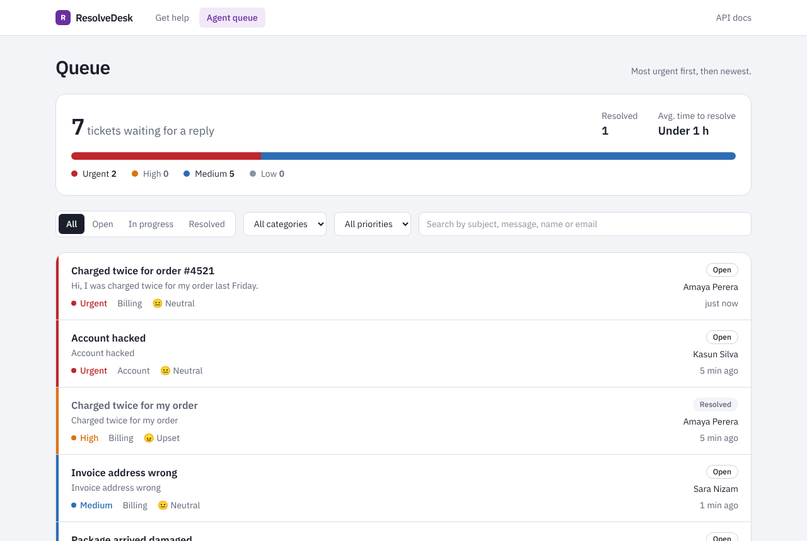
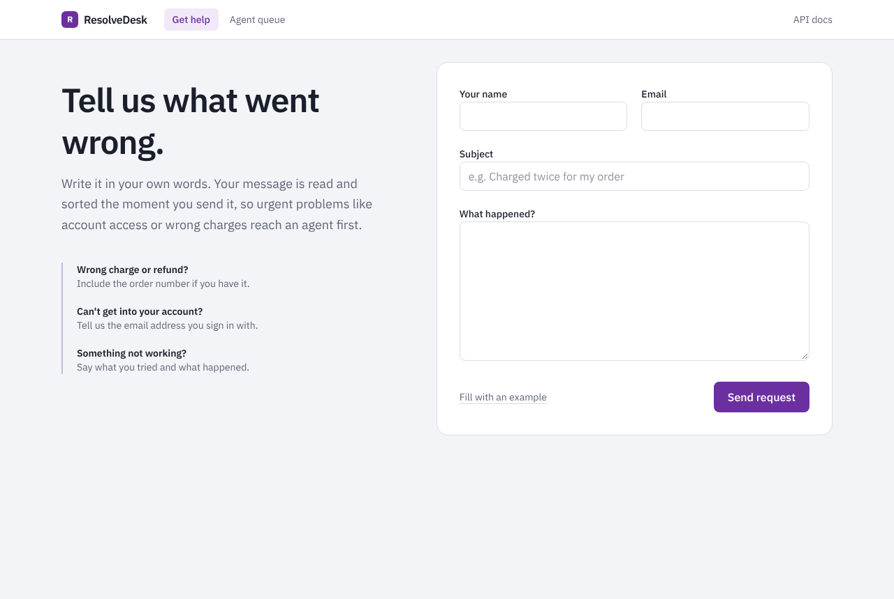
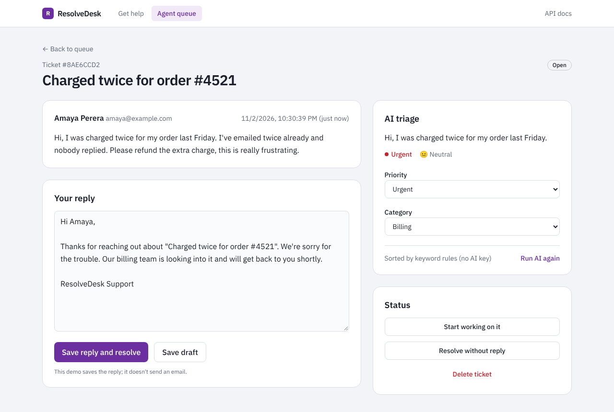

# ResolveDesk

A customer support ticketing app. Customers describe a problem in their own words, and every ticket is sorted by **category, priority and sentiment**, given a one-line summary and a draft reply. Support agents log in to a queue that always shows the most urgent tickets first.

Triage runs through the OpenAI API when an API key is configured. Without a key, a built-in rule-based classifier does the sorting, so the app works fully with no paid services. The current demo uses the rule-based classifier.



| Customer form | Ticket view with triage |
|---|---|
|  |  |

## Tech stack

| Layer | Tools |
|---|---|
| Frontend | Next.js (App Router), React, TypeScript, Tailwind CSS |
| Backend | NestJS, TypeScript, REST, class-validator DTOs |
| Database | PostgreSQL with TypeORM |
| Auth | JWT agent login, bcrypt password hashing, rate limiting (NestJS Throttler) |
| API docs | OpenAPI 3 generated from the code, Swagger UI at `/api/docs` |
| Triage | OpenAI Responses API with structured outputs (Zod schema), with a rule-based fallback |
| Testing | Vitest unit tests |
| Dev setup | Docker Compose for Postgres |

## How it works

```
Customer form (Next.js)  ── public, no login
        │  POST /api/tickets
        ▼
NestJS API ── ValidationPipe checks the DTO
        │
        ├── AiService ──► OpenAI (structured output: category, priority,
        │      │           sentiment, summary, suggestedReply)
        │      └── no key / API error ──► rule-based classifier
        ▼
PostgreSQL (tickets table)
        ▲
        │  GET /api/tickets  (Bearer token required)
Agent dashboard (Next.js) ── log in, edit reply, override triage, resolve
```

Design decisions:

- **Structured outputs, not free text.** When OpenAI is used, the model must return JSON that matches a Zod schema, so the API never parses free text. The schema uses the same enums as the database.
- **Triage never blocks the customer.** If there is no key or the OpenAI call fails, the rule-based classifier fills in and the ticket is marked `triageSource: "rules"`. Agents can click **Run AI again** later.
- **Humans stay in control.** Triage only drafts. Agents can change the priority or category and must save the reply themselves.
- **Only ticket submission is public.** Every agent endpoint needs a JWT from `POST /api/auth/login`. Login is limited to 5 attempts per minute.
- **Validation at the edge.** DTOs reject unknown fields, bad emails and empty messages with clear 400 errors, and IDs are checked as UUIDs.

## Run it locally

You need **Node.js 20+** and **Docker Desktop** (for Postgres). An OpenAI API key is optional.

```bash
# 1. Start Postgres
docker compose up -d

# 2. API
cd api
npm install
cp .env.example .env        # Windows PowerShell: copy .env.example .env
```

Fill in the two login values in `api/.env`. Run these inside the `api` folder:

```bash
# JWT_SECRET
node -e "console.log(require('crypto').randomBytes(48).toString('hex'))"
# AGENT_PASSWORD_HASH (replace with the password you want to log in with)
node -e "console.log(require('bcrypt').hashSync('your-password-here', 12))"
```

Then start the API (http://localhost:4000/api, docs at `/api/docs`):

```bash
npm run start:dev
```

```bash
# 3. Frontend (http://localhost:3000), in a second terminal
cd web
cp .env.example .env.local  # Windows PowerShell: copy .env.example .env.local
npm install
npm run dev
```

Open http://localhost:3000, click **Fill with an example** and send it. Then open **Agent queue** and log in with the password you hashed.

To use OpenAI for triage, add `OPENAI_API_KEY` to `api/.env` and restart the API. `GET /api/health` shows `"ai": "openai"` or `"ai": "rules"`.

> No Docker? Install PostgreSQL directly, create a database called `resolvedesk`, and update `DATABASE_URL` in `api/.env`.

### Tests

```bash
cd api && npm test
```

## API overview

Full interactive docs at `http://localhost:4000/api/docs` (OpenAPI JSON at `/api/docs-json`).

| Method | Path | Login | What it does |
|---|---|---|---|
| POST | `/api/tickets` | No | Submit a ticket; triage runs before saving |
| POST | `/api/auth/login` | No | Agent login, returns a JWT (5 attempts per minute) |
| GET | `/api/tickets` | Yes | List with `status`, `category`, `priority`, `search`, `page`, `limit` |
| GET | `/api/tickets/stats` | Yes | Counts for the dashboard |
| GET | `/api/tickets/:id` | Yes | One ticket |
| PATCH | `/api/tickets/:id` | Yes | Change status, reply, or override priority/category |
| POST | `/api/tickets/:id/retriage` | Yes | Run triage again |
| DELETE | `/api/tickets/:id` | Yes | Delete a ticket |
| GET | `/api/health` | No | Database and triage status |

## Project structure

```
resolvedesk/
├── docker-compose.yml         Postgres for development
├── api/                       NestJS backend
│   └── src/
│       ├── main.ts            CORS, validation, Swagger setup
│       ├── app.module.ts      Config, TypeORM, rate limiting
│       ├── auth/              Login endpoint, JWT guard
│       ├── ai/                OpenAI triage, schema, rule-based fallback (+ tests)
│       └── tickets/           Entity, DTOs, controller, service
└── web/                       Next.js frontend
    └── src/
        ├── app/               Pages: / (form), /login, /dashboard, /dashboard/tickets/[id]
        ├── components/        Queue pressure bar, ticket detail, tags
        └── lib/               Typed API client and labels
```

## Known limitations

- The agent token is kept in `sessionStorage` and expires after 1 hour. An HttpOnly cookie would be safer against XSS, but needs extra cross-domain and CSRF setup when the frontend and API are hosted separately.
- There is one shared agent account, not individual agent users.
- Tables are created with TypeORM `synchronize` in development. Migrations are planned before production use.
- Saving a reply does not email the customer.

## What I'd add next

- TypeORM migrations, with `DB_SYNC=false` in production
- Individual agent accounts with roles
- Sending replies by email, plus a page for customers to check ticket status
- e2e tests against a test database
